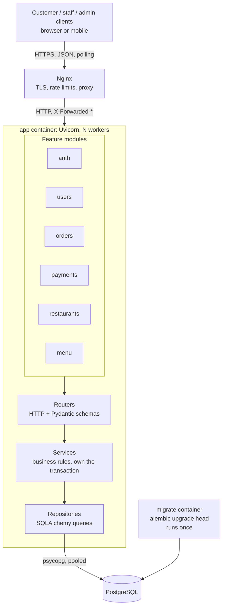
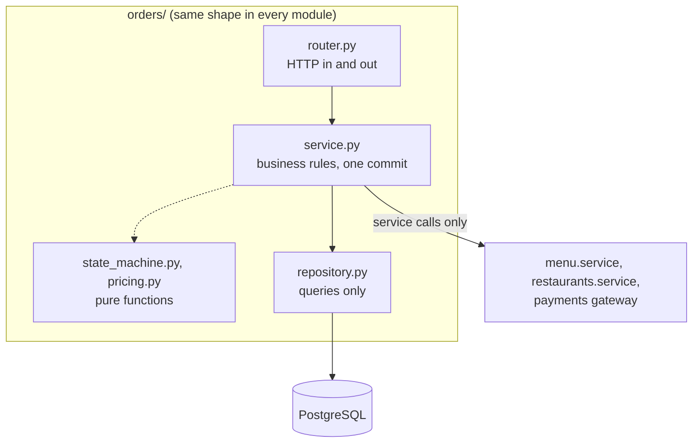
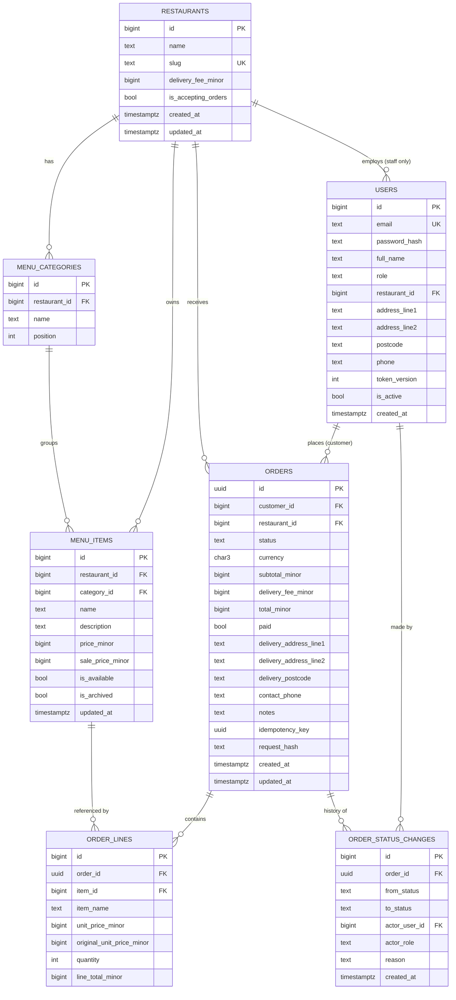
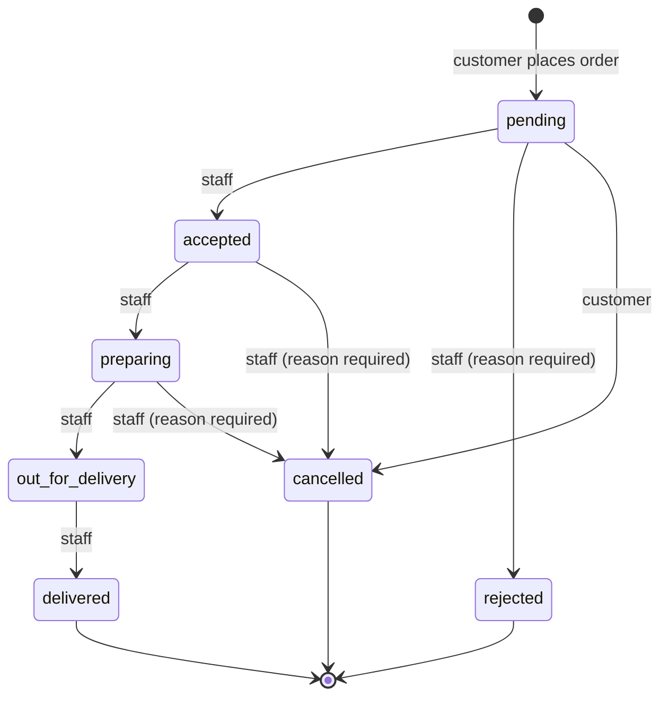

# Takeaway Ordering Platform: Backend Design

**Scope:** a backend for about 10 restaurants and about 100 orders an hour at peak, in a single region.
**Style:** a modular monolith built on FastAPI and PostgreSQL.
**Companion documents:** [GLOSSARY.MD](GLOSSARY.MD) defines the domain terms, and [architecture decisions](adr/) records the three decisions that are hard to reverse.

Bold domain terms (order line, status change, ...) are used exactly as [GLOSSARY.MD](GLOSSARY.MD) defines them.

## 1. Assumptions and open questions

### Decided assumptions

| \# | Assumption | Why | 
| ----- | ----- | ----- | 
| **A1** | There are three roles. A customer must register. A staff member belongs to exactly one restaurant. An admin onboards restaurants and staff, and can read any order but cannot change its status. | Least privilege for kitchens; someone still has to create restaurants. See ⬇️ **ADR 0001**. | 
| **A2** | An order belongs to one restaurant. The cart lives only on the client, and an order is created by a single `POST`. | Keeps cart state off the server. | 
| **A3** | Payment is mocked behind a `PaymentGateway` interface. The mock implementation marks every order `paid = true`. A refund is owed exactly when a paid order ends up rejected or cancelled. This is worked out from the order's status, so there is no refund column. | Payments are out of scope, but the interface means a real provider can be added without reworking orders (Appendix C). | 
| **A4** | Money is stored as integer minor units, in one platform currency set in config, and each order stores its `currency`. | See ⬇️ **ADR 0003**. | 
| **A5** | An order's total is the sum of its order lines plus the restaurant's flat delivery fee. Staff can give an item a sale price. There is no tax, tip or discount on the whole basket. | A sale price is a fixed amount, and a percentage is turned into a price when staff set it, so placing an order never rounds. | 
| **A6** | A menu has menu categories containing menu items, with no modifiers. An item can be unavailable (temporarily) or archived (permanently). Nothing is ever hard-deleted. | Modifiers would multiply the pricing and snapshot logic. Never deleting keeps every reference from past orders valid. | 
| **A7** | Each restaurant has one accepting orders switch, controlled by its staff. There is no opening-hours schedule. | Schedules need timezone and holiday rules, and add nothing to the architecture. | 
| **A8** | A pending order stays pending until staff act on it or the customer cancels. There is no auto-timeout and no scheduler. | This avoids adding a background worker. It is listed as a 10x item. | 
| **A9** | Live status is delivered by polling. | See ⬇️ **ADR 0002**. | 
| **A10** | Each customer can save one saved address, with a contact phone, on their profile. An order uses it by default, or the customer can send a one-off address for that order only. Either way the delivery address is copied. | Customers don't retype their details. Because the address is copied, editing the saved address never changes past orders. | 
| **A11** | Access tokens are JWTs that hold the user id and a `token_version`. They last 12 hours for staff and admins and 30 days for customers. There are no refresh tokens. The user is reloaded from the database on every request. | Deactivation and "log out everywhere" take effect immediately, and customers don't have to log in every day. | 
| **A12** | All timestamps are stored as `timestamptz` in UTC and set by the database (`now()`). | Avoids clock differences between app workers. | 

### Open questions (not blocking; each has a stated default)

1. **Modifiers (size, extras).** If they arrive, they would be snapshotted as child rows of an order line, with their own name and price. The pattern stays the same.
2. **Auto-rejecting stale pending orders.** Default: no. This needs a scheduler (see §11).
3. **Real payments.** These would bring in a payment status alongside the order status, a check when an order is placed that the total matches what the customer saw (`expected_total`), and authorise-then-capture. Appendix C describes the path to Stripe. The `PaymentGateway` interface and the idempotency design (§7.3) already fit it.
4. **Staff who work at more than one restaurant.** Today they need one account per restaurant. The upgrade path is a staff-to-restaurant membership table (ADR 0001).
5. **Delivery radius and address validation.** Not checked. The order stores whatever address the customer gave.
6. **Data retention and GDPR deletion.** Orders hold personal data (address and phone). The likely approach is to anonymise the contact fields of old orders and keep the financial fields. This is not designed here.

## 2. Architecture overview



There is one deployable unit (the FastAPI app), one database, and Nginx in front. No broker, cache or background worker is needed: every operation is a short request inside one transaction.

Each request passes through three layers:
* **Routers** handle HTTP only: they parse the request, check permissions through dependencies, and map the result to a response.
* **Services** hold the use cases (`place_order`, `change_status`). Each service function is one unit of work and commits once.
* **Repositories** hold queries and nothing else.

### Stack choices

| Choice | Recommendation | Trade-off | 
| ----- | ----- | ----- | 
| **Sync or async SQLAlchemy** | Sync (`Session`, psycopg 3), with endpoints declared as `def` | Simplest and best-documented path (the FastAPI SQL tutorial uses it). FastAPI runs `def` endpoints in a threadpool, which is plenty at this scale. The cost is that adding SSE later means its stream endpoint has to be `async def` (§11.1). | 
| **fastapi-users or custom JWT** | Custom, following the FastAPI "OAuth2 with JWT" tutorial (PyJWT + pwdlib/Argon2) | Login plus `get_current_user` is about 100 lines. fastapi-users adds email verification, password reset and OAuth flows we don't need, and its role model would still need custom code for restaurant scope. The cost is that we own the security-sensitive code, kept small and following the tutorial. | 
| **Uvicorn alone or Gunicorn + Uvicorn workers** | Uvicorn alone with `--workers` and `--proxy-headers` | The FastAPI deployment docs say Gunicorn is no longer needed now that Uvicorn manages its own workers. The cost is less elaborate process supervision, which Docker's `restart: unless-stopped` covers. | 

Changes from the fixed stack: none. The additions are libraries only: PyJWT, pwdlib and psycopg 3.

## 3. Project and module structure

Code is organised by feature, and each feature has its own router, service, repository, models and schemas. The FastAPI "Bigger Applications" docs leave it open whether to split by layer or by feature. Splitting by feature keeps each business area in one folder, which is the point of a modular monolith.

### The same three layers inside every module



| Layer | Allowed to | Not allowed to | 
| ----- | ----- | ----- | 
| **Router** | Parse and validate requests (Pydantic), call `require_role`, call its own module's service, map results and errors to HTTP | Run queries, contain business rules, commit | 
| **Service** | Enforce business rules, call its own repository, its own pure functions and other modules' services, commit once per use case | Know about HTTP: no `Request`, status codes or `HTTPException` | 
| **Repository** | Build and run SQLAlchemy queries for its own module's tables | Commit, call services, or touch another module's tables | 

```
takeaway/
├── app/
│   ├── main.py            # create_app(): mount routers under /api/v1, register exception handlers, lifespan
│   ├── cli.py             # `python -m app.cli create-admin`: bootstraps the first admin
│   ├── core/
│   │   ├── config.py      # Settings(BaseSettings) from env/.env; @lru_cache get_settings()
│   │   └── db.py          # engine, sessionmaker, SessionDep (one session per request), Base + naming convention
│   ├── security.py        # hash/verify password (pwdlib), encode/decode JWT (PyJWT)
│   ├── errors.py          # DomainError hierarchy, mapped to HTTP responses by exception handlers
│   ├── auth/
│   │   ├── router.py      # /auth/register, /auth/token
│   │   ├── dependencies.py # CurrentUser, require_role(...): the only place tokens are read
│   │   └── schemas.py     # RegisterIn, TokenOut
│   ├── users/
│   │   ├── models.py      # User (incl. saved address, token_version), Role enum
│   │   ├── repository.py  # get_by_id, get_by_email
│   │   ├── service.py     # register_customer, update_profile, create_staff, deactivate_user, log_out_everywhere
│   │   ├── schemas.py     # MeOut, ProfileUpdate, SavedAddress
│   │   └── router.py      # /me (GET, PATCH), /users/{uid} (admin)
│   ├── restaurants/
│   │   ├── models.py      # Restaurant
│   │   ├── repository.py
│   │   ├── service.py     # create/update (admin), set_accepting_orders (staff), get_for_ordering()
│   │   ├── schemas.py
│   │   └── router.py      # public browsing, admin onboarding, accepting-orders switch
│   ├── menu/
│   │   ├── models.py      # MenuCategory, MenuItem
│   │   ├── repository.py
│   │   ├── service.py     # category/item editing, sale prices; get_orderable_items() for orders
│   │   ├── schemas.py
│   │   └── router.py      # public menu, staff menu management
│   ├── payments/
│   │   ├── gateway.py     # PaymentGateway protocol + MockPaymentGateway (always succeeds)
│   │   └── dependencies.py # get_payment_gateway(): picks the implementation from settings
│   └── orders/
│       ├── models.py      # Order, OrderLine, OrderStatusChange
│       ├── state_machine.py # pure transition table + check_transition(); no I/O
│       ├── pricing.py     # pure: (items incl. sale prices, quantities, delivery fee) -> lines + totals
│       ├── repository.py  # visible_to(user) query, conditional status UPDATE
│       ├── service.py     # place_order, change_status, list/get scoped by role
│       ├── schemas.py
│       └── router.py
├── alembic/               # env.py imports Base.metadata; versions/ (one migration per change)
├── tests/
│   ├── conftest.py        # DB, session-rollback and client fixtures
│   ├── unit/              # state_machine, pricing, idempotency hashing
│   └── integration/       # API + real Postgres
├── nginx/nginx.conf
├── Dockerfile
├── docker-compose.yml
├── alembic.ini
└── pyproject.toml
```

### Rules for module boundaries
* A module only calls another module's `service` functions. It never reads another module's tables or repositories. For example, `orders` asks `menu.service.get_orderable_items(restaurant_id, item_ids)` and `restaurants.service.get_for_ordering(id)`. It does not query `menu_items` itself.
* Dependencies point one way: `orders -> menu -> restaurants`, `orders -> users`, `orders -> payments`, and `auth -> users`, with no cycles. The tool `import-linter` can enforce this in CI with a five-line contract.
* `state_machine.py` and `pricing.py` are pure functions. The rules that matter most can therefore be tested without a database.

## 4. Data model




### Constraints, and why each exists
* Staff belong to exactly one restaurant: `CHECK ((role = 'staff') = (restaurant_id IS NOT NULL))`. The database itself rejects a staff member with no restaurant, or a customer linked to one.
* A menu item's category belongs to the same restaurant: a composite FK `(category_id, restaurant_id) -> menu_categories(id, restaurant_id)`, backed by a `UNIQUE (id, restaurant_id)` on categories. Without it, a bug could put Pizza Roma's item into another restaurant's "Drinks" category.
* Snapshot columns on `order_lines`: `item_name`, `unit_price_minor` (the price charged, which is the sale price if one was set) and `original_unit_price_minor` (the normal price) are copied when the order is placed and never updated. `CHECK (unit_price_minor <= original_unit_price_minor)`. `menu_item_id` stays as a plain FK (`ON DELETE RESTRICT`) for reporting. This is safe because menu items are archived, never deleted.
* A sale price is a real reduction: `CHECK (sale_price_minor IS NULL OR (sale_price_minor > 0 AND sale_price_minor < price_minor))`. Removing a sale means setting it back to `NULL`.
* Only customers have a saved address: `CHECK (role = 'customer' OR (address_line1 IS NULL AND phone IS NULL))`. Orders copy the address fields and keep no reference to the user's saved address, so saved addresses can be edited freely.
* Arithmetic checks: `line_total_minor = unit_price_minor * quantity` and `total_minor = subtotal_minor + delivery_fee_minor`. The database refuses to store a total that doesn't add up. The service also checks that `subtotal_minor` equals the sum of the lines.
* Status is `text` + `CHECK`, not a Postgres `ENUM`. Adding a value to a native enum inside an Alembic migration is awkward (it can't be done inside a transaction on older Postgres versions). Changing a `CHECK` constraint is a plain migration.
* Order ids are UUIDs. Order ids appear in URLs that customers share and poll, so random UUIDs don't reveal how many orders there are. Every other table uses `bigint GENERATED ALWAYS AS IDENTITY`.
* The status history is append-only. The app's database role is granted only `SELECT` and `INSERT` on `order_status_changes`. Nothing in the app can rewrite history, even through a bug.
* Naming convention: `Base.metadata` uses a `naming_convention` for ix/uq/ck/fk/pk, as the SQLAlchemy docs recommend. Alembic autogenerate then produces stable, predictable constraint names. (kiki-agents doesn't use one; see Appendix B.)

### Indexes
| Index | Serves |
| :--- | :--- |
| `orders (customer_id, created_at DESC)` | Customer: "my orders" |
| `orders (restaurant_id, status) WHERE status IN ('pending', 'accepted', 'preparing', 'out_for_delivery')` | Staff: active-orders poll (partial index, stays small) |
| `orders (restaurant_id, created_at DESC)` | Staff and admin: order history |
| `UNIQUE orders (customer_id, idempotency_key)` | Idempotent order creation (§7.3) |
| `order_lines (order_id), order_status_changes (order_id, created_at)` | Order detail and history |
| `menu_items (restaurant_id, category_id) WHERE NOT is_archived` | Public menu |
| `UNIQUE users (lower(email))` | Login; stops duplicate accounts that differ only in letter case |

## 5. API endpoints

Every path is prefixed with `/api/v1`.
* "Own" means the restaurant must be the staff member's own restaurant. Otherwise the response is `404`.
* "Scoped" means the result depends on the caller: a customer sees their own orders, staff see their restaurant's orders, and an admin sees all orders.

| Method | Path | Role | Purpose |
| :--- | :--- | :--- | :--- |
| POST | `/auth/register` | public | Create a customer account |
| POST | `/auth/token` | public | Log in with the OAuth2 password form; returns an access token |
| GET | `/me` | any | Current user, role, restaurant and (for customers) saved address |
| PATCH | `/me` | customer | Update name, saved address and phone |
| POST | `/me/log-out-everywhere` | any | Bump `token_version`, which invalidates every token already issued |
| GET | `/restaurants` | public | List restaurants and whether each is accepting orders |
| GET | `/restaurants/{rid}` | public | Restaurant detail, including the delivery fee |
| GET | `/restaurants/{rid}/menu` | public | Categories and non-archived items; unavailable items are flagged |
| GET | `/orders` | scoped | List orders. Staff use `?active=true` for the kitchen view. |
| GET | `/orders/{oid}` | scoped | Order detail, including order lines and status history. This is the customer's polling target. |
| POST | `/orders/{oid}/status-changes` | customer, staff | Request a status change: `{"to_status": "...", "reason": "..."}` |
| GET | `/healthz`, `/readyz` | public (internal) | Liveness, and readiness including a database ping |

### Design notes
* Status changes are a resource. Instead of separate `/accept`, `/reject` and `/cancel` endpoints, there is one `POST /orders/{oid}/status-changes` endpoint, which mirrors the status change concept. One endpoint means the permission check (§6) lives in one place.
* Errors use FastAPI's default `{"detail": ...}` shape plus a machine-readable code, for example `{"detail": "Order is no longer pending", "code": "status_conflict"}`. Validation errors keep FastAPI's standard 422 body.

| Status | Codes |
| :--- | :--- |
| 400 | `idempotency_key_required` |
| 401 | not authenticated, or token expired |
| 403 | role not allowed for this endpoint or transition (`transition_not_permitted`) |
| 404 | not found, or outside the caller's scope, so existence isn't leaked |
| 409 | `invalid_transition`, `status_conflict`, `restaurant_not_accepting_orders`, `item_unavailable` |
| 422 | validation errors; `idempotency_key_reused` (same key, different body); `delivery_address_required` (no one-off address and none saved) |

* Lists use keyset pagination (`?cursor=<created_at,id>&limit=50`). The kitchen view doesn't paginate, because the number of active orders is bounded by kitchen capacity.

## 6. Order state machine



| From | To | Allowed role | Reason | Notes |
| :--- | :--- | :--- | :--- | :--- |
| (none) | pending | customer | none | Written when the order is placed (`from_status = NULL`) |
| pending | accepted | staff | none |  |
| pending | rejected | staff | required | The restaurant declines the order. A refund is owed. |
| pending | cancelled | customer | optional | The only way a customer can cancel. A refund is owed. |
| accepted | preparing | staff | none |  |
| accepted | cancelled | staff | required | For example, an item has run out. A refund is owed. |
| preparing | out_for_delivery | staff | none | Staff mark this themselves, because there is no driver app. |
| preparing | cancelled | staff | required |  |
| out_for_delivery | delivered | staff | none |  |

* Terminal statuses: `delivered`, `rejected` and `cancelled`.
* Anything not in the table returns `409 invalid_transition`.
* A pair that is in the table but not allowed for the caller's role (for example, a customer cancelling an `accepted` order) returns `403 transition_not_permitted`.
* Admins appear in no row: they can read orders but never change them.
* Restaurant scope: "staff" always means staff of the order's restaurant. Staff of another restaurant get `404`, because the order isn't visible to them (§8).

The table is plain data in `orders/state_machine.py`, so the diagram, the docs and the tests all come from the same source:

```python
TRANSITIONS: dict[tuple[Status, Status], Rule] = {
    (Status.PENDING, Status.ACCEPTED): Rule(roles={Role.STAFF}),
    (Status.PENDING, Status.REJECTED): Rule(roles={Role.STAFF}, reason_required=True),
    (Status.PENDING, Status.CANCELLED): Rule(roles={Role.CUSTOMER}),
    (Status.ACCEPTED, Status.CANCELLED): Rule(roles={Role.STAFF}, reason_required=True),
    # ...
}
```

## 7. Key challenges

Each challenge is split into Findings (what the sources say; the full list is in Appendix A) and Decision (what we do and why). Items marked (*added*) were not in the original brief.

### 7.1 Enforcing valid transitions and who may make them
**Findings.** Deliveroo's partner API allows only a fixed set of order-status transitions and returns `409 Conflict` with `invalid_status_transition` for anything else [A1]. Stripe models PaymentIntents as a closed set of states, in which cancellation "can't be undone" [A2].

**Decision.** `change_status(order_id, to_status, reason, user)` runs these steps in order:
1. Load the order through the caller's scoped query (§8). If it's outside scope, return `404`.
2. Call `check_transition(from, to, role, reason)`, a pure function over the table in §6. It raises `invalid_transition`, `transition_not_permitted` or `reason_required`.
3. Run the conditional update (§7.5).
4. Insert the status change.
5. Commit.

There is no state-machine library: a dictionary and one function are enough to read, and they're easy to test exhaustively.

### 7.2 Snapshotting names and prices onto orders
**Findings.** Shopify's LineItem exposes the unit price and the product title "at time of order creation" [A3]. Stripe advises against changing a Price's amount. You create a new Price instead, so the old one stays "an immutable record of past transactions" [A4].

**Decision.**
* `order_lines` stores `item_name`, the price charged (`unit_price_minor`) and the normal price (`original_unit_price_minor`), copied when the order is placed. A receipt can therefore show "was €12.50" even after the sale ends.
* `orders` stores `delivery_fee_minor`, `currency` and the delivery address, copied from the saved address or from the one-off address in the request.
* Menu edits update `menu_items` in place and never touch past orders.
* We keep `menu_item_id` for reporting. Menu items can't be deleted (A6), so the reference never breaks.
* We deliberately do not version menu items, as Stripe's create-a-new-Price model does. The snapshot already protects order history, and versioning would make menu editing more complicated.

### 7.3 Idempotent order creation
**Findings.**
* Stripe saves the result of the first request for each idempotency key and returns the same result on retries. It recommends V4 UUIDs as keys and rejects a reused key sent with different parameters [A5].
* Brandur Leach's Postgres design uses a unique `(user_id, idempotency_key)` index, plus "recovery points" for requests that call external services [A6].
* Shopify needs keys to be unique only within a retry window, typically 24 hours or less [A7].
* Grab drops duplicate messages using a unique key [A8].

**Decision.**
* The client generates a UUID v4 for each checkout attempt and sends it as `Idempotency-Key`. If the header is missing, the response is `400`.
* The key is stored on the order row, with `UNIQUE (customer_id, idempotency_key)`, together with `request_hash`, the SHA-256 of the validated request body serialised in a canonical form.

The flow, all in one transaction:
1. Look up `(customer_id, key)`.
   * If found with the same hash, return the existing order: `201` with the same body, plus the header `Idempotent-Replayed: true`.
   * If found with a different hash, return `422 idempotency_key_reused`.
2. Otherwise validate, price and insert the order, its lines, and the first status change.
3. If two identical requests arrive at the same moment, both pass step 1 and the unique constraint makes the second insert fail. Catch the `IntegrityError`, roll back, and go back to step 1, which now finds the winner's order.

**What we leave out, and why.**
* No separate idempotency-key table and no clean-up job. The key's lifetime is the order's lifetime. That needs no scheduler (A8), and it's stricter than Stripe's 24-hour window without costing more.
* No recovery points. Brandur's multi-step recovery is for requests that call external services such as payment providers. Placing an order here is a single database transaction, so it either happens completely or not at all.
* Failed requests aren't stored. A retry after a `409 item_unavailable` simply runs again, which is correct because nothing was created.

### 7.4 Money handling
**Findings.** Stripe takes amounts as integers in the currency's smallest unit (1099 = $10.99) and has special cases for currencies without decimal places [A9]. The PostgreSQL wiki warns against the `money` type and recommends `numeric` "or (rarely) integer", with the currency in a separate column [A10]. Martin Fowler notes how easily pennies are lost to rounding, and proposes a Money type [A11].

**Decision.**
* All amounts are `BIGINT` minor units and are named `*_minor` everywhere: database columns, Python attributes and JSON fields.
* In Pydantic they are `int` fields, never `float`.
* All arithmetic stays in integers inside `orders/pricing.py`.
* Each order stores `currency`.

What goes wrong with float: in Python, `3 * 1.10` is `3.3000000000000003`. A check like `total == sum(lines)` then fails, and reports that add up many orders drift by cents.

**Discounts.** How money is stored doesn't decide how discounts work. When rounding happens does.
* Staff set a sale price, a fixed amount such as €9.99 instead of €12.50.
* If staff enter a percentage, the menu service turns it into a sale price once, when it is saved (rounding half up), and shows staff the result.
* Placing an order therefore never rounds. Pricing just uses the sale price if there is one, and the normal price otherwise.
* Discounts on the whole basket, or several discounts on one item, would need a single rounding function in `pricing.py`. They are out of scope.

Full rationale and alternatives: ⬇️ ADR 0003.

### 7.5 Concurrent status updates on the same order
**Findings.**
* At Postgres's default Read Committed isolation, a blocked `UPDATE ... WHERE` re-checks its condition against the newly committed row. A guarded update therefore affects zero rows if the status has already changed [A12].
* `SELECT ... FOR UPDATE` is the alternative: it locks the row until commit [A13].
* SQLAlchemy's `version_id_col` provides optimistic locking that raises `StaleDataError` [A14].

**Decision.** Use a conditional update that checks the status we expect:

```python
result = session.execute(
    update(Order)
    .where(Order.id == order_id, Order.status == expected_from)
    .values(status=to_status, updated_at=func.now())
)
if result.rowcount == 0:
    raise StatusConflict()  # 409: refetch and retry
```

**Example.** A customer presses Cancel at the same moment the kitchen presses Accept. Both requests read `pending`, and both pass `check_transition`. Postgres makes one `UPDATE` wait for the other. When the waiting one runs, it re-checks `status = 'pending'` and matches zero rows, so that caller gets `409 status_conflict`. Exactly one status change is recorded.

**Why not the alternatives.**
* `FOR UPDATE` works too, but holds a lock for the whole request.
* A version column would also reject concurrent edits to the order's other fields, but nothing else on an order can be changed after it's placed. The status itself already acts as the version.

### 7.6 Delivering live status to customers
**Findings.**
* At one point, 80% of the requests reaching Uber's API gateway were polling calls. Uber then moved to SSE [A15], and later to gRPC, because SSE only sends one way and Uber couldn't confirm delivery [A16].
* SSE reconnects automatically. Over HTTP/1.1, browsers allow only 6 connections per domain [A17].
* Postgres `NOTIFY` is delivered on commit, with payloads under 8,000 bytes [A18].
* The notifier pattern uses one listening connection per process [A19].
* Recall.ai found that `NOTIFY` takes a global lock at commit, which stalled its database under tens of thousands of concurrent writers [A20].

**Decision.** Use polling:
* Customers poll `GET /orders/{oid}` about every 10 seconds while the order is active, and stop once it reaches a terminal status.
* Staff poll `GET /orders?active=true` about every 10 seconds.

**Load estimate:**
* About 100 active orders at peak, polled every 10 seconds, is about 10 requests per second. Each one is a primary-key read, which is trivial for one Postgres instance.
* The staff view returns *every* active order rather than "changes since a cursor". Cursors based on `updated_at` can miss updates when transactions commit out of order, and a kitchen's active list is short anyway.

SSE with LISTEN/NOTIFY is the planned upgrade path (§11). Full rationale: ⬇️ ADR 0002.

### 7.7 Audit trail of status changes
**Findings.**
* Deliveroo's status webhook carries a `status_log`: a list of statuses, each with a timestamp [A21].
* Fowler: "The glory of Audit Log is its simplicity", but a log is "easy to write but harder to read" [A22].
* A transactional outbox writes outgoing messages in the same transaction as the business change [A23].

**Decision.**
* Use the append-only `order_status_changes` table. Each row records from, to, who (user id and role), why (reason) and when.
* Each row is written in the same transaction as the status update, so the history and the current status can't disagree.
* `orders.status` is a denormalised copy of the latest status change, kept for cheap reads and filtering.
* The database role only allows inserts, never updates or deletes, on this table (§4).
* No event sourcing and no outbox: there's nothing asynchronous that would consume the events yet (§11).

**Scope.** Only status changes are audited, which is what the brief asks for. Menu price edits aren't audited, because the order snapshots already keep what each customer actually paid.

### 7.8 Role-based access control
See §8. The key point: role checks happen in route dependencies, and scope checks happen in a single query function, so "can this caller see this order?" has exactly one implementation.

### 7.9 Isolating restaurants from each other (*added*)
A staff member from Pizza Roma must never see or change another restaurant's orders or menu.
* `orders.repository.visible_to(user)` is the only way to read orders. It adds `WHERE customer_id = :me` for customers and `WHERE restaurant_id = :mine` for staff, and no filter for admins.
* Menu and restaurant writes check that the `rid` in the path equals `user.restaurant_id`.
* A cross-restaurant request gets `404`, not `403`.

The integration tests cover the full combination of role and restaurant (§10).

### 7.10 Never trusting client prices (*added*)
The client sends only `menu_item_id` and `quantity`. The server loads the items with `restaurant_id = :rid AND NOT is_archived`, and returns `409 item_unavailable` if any requested id is missing or unavailable. It then prices each line at the item's sale price if one is set, or its normal price otherwise, and returns the confirmed total.

Two smaller rules:
* Sending the same item twice in one order is a `422`. The client should send one line with a higher quantity.
* Quantities must be between 1 and 20.

### 7.11 Reading the menu and then writing the order (*added*)
The order is placed in one transaction, which reads the restaurant and items and then inserts the order. Two edge cases:
* The restaurant switches accepting orders off mid-request. The order may still land as pending, and staff can reject it. This is acceptable, and it avoids locking restaurant rows.
* A price changes mid-request. The order snapshots the price it read. This is also acceptable, and it is exactly what snapshotting guarantees.

### 7.12 Safe schema changes (*added*)
* Alembic manages every schema change.
* A one-shot `migrate` container runs `alembic upgrade head` before the app starts (§9).
* Migrations follow expand-then-contract: add the new column first, deploy the app, and only drop the old one in a later release, so a rolling restart never runs code against a schema it doesn't expect.
* CI runs `alembic check` to fail any build whose models and migrations disagree.

## 8. Authentication and authorization

### Authentication
This follows the FastAPI "OAuth2 with Password and JWT" tutorial:
* **Passwords are hashed with Argon2 through `pwdlib`.** The hash is still needed even though we use JWTs. A JWT replaces the session, not the password: login checks the password against the stored hash once, and then issues a signed token that later requests send instead.
* **Login:** `POST /auth/token` takes the standard OAuth2 password form and returns `{"access_token", "token_type": "bearer"}`. Only customers can register themselves. Admins create staff accounts, and the first admin is created with `python -m app.cli create-admin`.
* **Token:** a JWT signed with HS256, using a secret from settings. It holds `sub` (the user id), `ver` (the user's `token_version`), `iat` and `exp`.
  * `exp` is 12 hours for staff and admins, which covers a shift, and 30 days for customers, so they stay logged in.
  * Role and restaurant are deliberately not in the token.
* **`get_current_user` dependency:** it decodes the token, loads the `User` by primary key, and rejects the request with `401` if the user is missing or inactive, or if `ver` doesn't match `token_version`.
  * Deactivating someone, or moving them to another restaurant, takes effect on their very next request.
  * Changing a password or calling `POST /me/log-out-everywhere` bumps `token_version`, which invalidates every token already issued.
  * The cost is one indexed lookup per request.
* **Not included:** refresh tokens, email verification, password reset, MFA and social login. When those features are wanted, the upgrade path is an external identity provider such as Keycloak or Auth0 (§11). The app would then only validate OIDC tokens and stop storing passwords. All traffic is HTTPS, terminated at Nginx.

```python
CurrentUser = Annotated[User, Depends(get_current_user)]

def require_role(*roles: Role):
    def dep(user: CurrentUser) -> User:
        if user.role not in roles:
            raise Forbidden()
        return user
    return Depends(dep)
```

### Authorization happens in three layers

| Layer | Question | Where | Failure |
| :--- | :--- | :--- | :--- |
| Role | "Can this kind of user call this endpoint at all?" | `require_role(...)` on the route | 403 |
| Scope | "Is this resource yours, or your restaurant's?" | `visible_to(user)` for orders, and a `rid == user.restaurant_id` check for menu and restaurant writes | 404 |
| Transition | "Can this role make this status change?" | `check_transition` (§6) | 403 or 409 |

Why staff belong to one restaurant: see ⬇️ ADR 0001. In short, it gives least privilege, it matches how a kitchen actually works, and scoping is a single `WHERE` clause.

**Permissions by resource:**

| Resource | Customer | Staff | Admin |
| :--- | :--- | :--- | :--- |
| Restaurants and menus (read) | ✔ | ✔ | ✔ |
| Restaurant: create, edit, delivery fee | | | ✔ |
| Accepting orders switch | | own | |
| Menu: categories and items (write) | | own | |
| Users: create staff, deactivate | | | ✔ |
| Orders: place | ✔ | | |
| Orders: read | own | own restaurant | all |
| Orders: change status | per §6 | own restaurant, per §6 | |

## 9. Deployment

All services run on a single host with `docker-compose`:

| Service | Image | Role |
| :--- | :--- | :--- |
| `nginx` | `nginx:stable` | The only public entry point, on ports 80 and 443. It terminates TLS, redirects HTTP to HTTPS, and proxies requests to `app:8000`. |
| `app` | built from `Dockerfile` (python:3.12-slim, non-root user) | Runs `uvicorn app.main:app --host 0.0.0.0 --port 8000 --workers 2 --proxy-headers --forwarded-allow-ips=*`. CMD uses exec form, so signals reach Uvicorn and shutdown is graceful. It has a healthcheck on `/readyz` and `restart: unless-stopped`. |
| `migrate` | same image | A one-shot `alembic upgrade head`. `app` waits for it with `depends_on: {migrate: {condition: service_completed_successfully}}` |
| `db` | `postgres:16` | A named volume for data and a `pg_isready` healthcheck. It is not published to the host, only to the internal compose network. |

**Notes on this setup:**
* `--forwarded-allow-ips=*` is safe only because the app's port is reachable safely from Nginx on the internal network.
* **Secrets** (`JWT_SECRET`, `DATABASE_URL`) come from environment variables or a `.env` file that is never committed, and are read by pydantic-settings.
* **Database connections:** each worker has `pool_size=10` and `max_overflow=5`. FastAPI runs `def` endpoints in a threadpool of 40 threads, and requests queue for a pooled connection when all ten are busy. Two workers therefore open at most 30 connections, comfortably under Postgres's default limit of 100.

**What Nginx does, which is why it sits in front of Uvicorn instead of exposing Uvicorn directly:**
* **TLS termination and HTTP-to-HTTPS redirects**, so the app only speaks plain HTTP internally.
* **Rate limiting per client IP** with `limit_req`, on the endpoints worth attacking:
  * `/auth/token`: 5 requests a minute, burst of 10, against password guessing.
  * `POST /orders`: 10 requests a minute.
* **Request hygiene:** `client_max_body_size 64k`, timeouts, and buffering of slow clients so they don't tie up Uvicorn workers.
* **Proxy headers** (`X-Forwarded-For`, `X-Forwarded-Proto`, and an `X-Request-ID` from `$request_id`). The app logs the request id in structured JSON logs, so one request can be traced from Nginx through the app.
* **Gzip for JSON responses.**
* Polling needs no special Nginx configuration. SSE would need `proxy_buffering off` and long read timeouts (§11).

**Backups:** a nightly `pg_dump` from the host's cron, kept off the box. In production, a managed Postgres with point-in-time recovery would replace this (§11).

## 10. Testing strategy

| Level | What | How |
| :--- | :--- | :--- |
| Unit (no database) | `state_machine.check_transition` | Exhaustive, table-driven: every (from, to, role) combination, 7 x 7 x 3 = 147 cases. Each is checked against the §6 table, so a new transition can't be added without a matching test. |
| Unit | `pricing` | Line totals, subtotal and delivery fee; the sale price is used when set and the normal price recorded as original; rejecting a quantity of 0 or 21 or a duplicate item. Every money value is asserted to be an `int`. |
| Unit | Percentage to sale price | 15% off 1250 gives 1063 (half up); a result of 0, or not below the normal price, is rejected. |
| Unit | Idempotency hashing | The same body in a different key order gives the same hash; a different body gives a different hash. |
| Integration (API + real Postgres) | Placing an order | Happy path; restaurant not accepting orders; item unavailable, archived, or from another restaurant (each `409`); missing `Idempotency-Key` (`400`) |
| Integration | Snapshotting | Place an order, change the item's name, price and sale price and the customer's saved address, then check that `GET /orders/{oid}` still shows the original values. |
| Integration | Token revocation | After `log-out-everywhere`, a password change or deactivation, the old token gets `401`; a staff token is refused after 12 hours (clock fixed in the test). |
| Integration | Payment seam | A fake gateway that declines payment: no order, lines or history are written. Tests otherwise use `MockPaymentGateway` through `dependency_overrides`. |
| Integration | Idempotency | Replaying a request returns the same order id and only one row exists; the same key with a different body gives `422`. |
| Integration | Authorization matrix | Parametrised over customer A, customer B, staff of restaurant X, staff of restaurant Y, and admin, against each order and menu endpoint. Checks every `404` / `403` boundary in §8. |
| Integration | Status changes over HTTP | Each allowed status change appears in the history with the right actor; a required reason is enforced. |
| Concurrency | Two status changes on one order at the same moment | Two threads, each with its own connection, try cancel and accept together. Exactly one succeeds, the other gets `409`, and there are exactly two history rows (placed plus one change). The same approach covers two order placements with the same idempotency key at once. |
| Migrations | Schema matches the models | `alembic upgrade head` on an empty database, then `alembic check` shows no differences. |

**Test fixtures and isolation**
* Real Postgres is started by `docker compose -f docker-compose.yml -f docker-compose.test.yml`. We don't use SQLite, because CHECK constraints, partial indexes and locking behave differently there.
* Each test runs inside a transaction that is rolled back, using SQLAlchemy's "Joining a Session into an External Transaction" recipe (`join_transaction_mode="create_savepoint"`). The app's `get_session` dependency is replaced with `app.dependency_overrides`, which is reset after each test.
* Concurrency tests need real commits, so they skip the rollback fixture, are marked `@pytest.mark.concurrency`, and empty their tables afterwards.
* Auth isn't mocked in integration tests. A helper creates a user and gets a real token through `/auth/token`, so authentication and authorization are tested end to end.
* Tools: plain pytest functions with FastAPI's `TestClient`, and small factory functions instead of a fixture framework.

Compared with kiki-agents: kiki-agents uses unittest-style `IsolatedAsyncioTestCase` and cleans its database with `DELETE FROM` before each test. We follow the FastAPI testing docs (plain pytest) and use per-test rollback, which is faster and needs no clean-up ordering. Both use a real Postgres from docker-compose and both rely on `dependency_overrides`.

## 11. What changes at 10x

At 10x, the platform handles about 100 restaurants and about 1,000 orders an hour, which is still only about 0.3 orders a second. Polling load would be about 100 requests a second of primary-key reads. A single Postgres instance handles that easily, so the architecture stays the same: still one modular monolith, no broker, no Kubernetes. What changes is operations and some features we deliberately left out.

| Area | Change | Trigger |
| :--- | :--- | :--- |
| Availability | Run 2 or more `app` containers (they're already stateless) behind Nginx `upstream`, on two hosts or a managed container service. | One host becomes an outage risk the business won't accept. |
| Database | Managed Postgres with point-in-time recovery and a standby. Add PgBouncer (transaction pooling) when total app connections approach `max_connections`. A read replica only if order history or reporting queries start to compete with writes. | Connection count, recovery targets. |
| Live status | Move from polling to SSE, as designed in §11.1. This supersedes ⬇️ ADR 0002. | Polling dominates traffic, or the product wants instant updates. Even then NOTIFY is far below the contention Recall.ai hit; Redis pub/sub is the next step beyond that. |
| Payments | Real payments through Stripe, as described in Appendix C. | The business stops mocking payments. This is driven by features, not scale. |
| Background work | A small worker plus scheduler, for example a `jobs` table drained with `SELECT ... FOR UPDATE SKIP LOCKED`, or just rq/Celery. | The first asynchronous side effect appears (notifications), or auto-reject is wanted. |
| Auth | An external identity provider (Keycloak, Auth0 or Cognito), with the app only validating OIDC tokens. That provides password reset, MFA and social login. Alternatively, short access tokens plus rotating refresh tokens, if the per-request user lookup ever has to go. | Wanting MFA or social login, or a higher account-takeover risk. Load alone doesn't justify it: a primary-key lookup per request stays trivial at 10x. |
| Staff | A staff-to-restaurant membership table, so one person can work at several restaurants. Per-restaurant roles (manager vs kitchen). | Restaurant groups and chains. |
| Domain | Opening-hours schedules, modifiers, delivery radius checks. | Product needs, not scale. |
| Observability | Prometheus metrics (latency, 409 rate, orders by status), alerts on error rate and pending-order age, tracing. | More traffic means less is noticed by eye. |
| Rate limiting | Per-user limits in the app as well as per-IP limits in Nginx. | Traffic from shared IPs (offices, mobile carriers). |

What would still not justify microservices: none of the modules has an independent scaling profile or a separate team, and the order transaction (validate the menu, write the order and its history) is much simpler as a local database transaction than as a distributed one.

### 11.1 Moving to SSE

Estimated at about 200 lines plus configuration and tests, roughly 1-2 days. The risky parts are sending events across workers and auth.

| Piece | What it involves |
| :--- | :--- |
| Stream endpoint | `GET /orders/{oid}/events`, declared `async def`, so each open stream doesn't hold one of the 40 threadpool threads. The rest of the app stays sync. The stream holds no database session while it waits. |
| Sending events across workers | A status change made in worker 1 must reach a stream open on worker 2. Each worker keeps one `LISTEN order_status` connection. `change_status` calls `pg_notify('order_status', order_id)` in its own transaction, so the notification is sent on commit. The worker then forwards it to its local subscribers by order id. |
| Missed events | Each stream first sends the current status read from the database, then the changes. A notification lost during a reconnect therefore never leaves a client out of date. |
| Nginx | `proxy_buffering off`, a long `proxy_read_timeout`, a heartbeat comment every 20 seconds, and HTTP/2 to avoid the browser's limit of 6 connections per domain. |
| Auth | The browser `EventSource` API can't send an `Authorization` header. The options are a cookie for this endpoint, or a fetch-based SSE client. A token in the query string is rejected because it ends up in logs. Mobile clients aren't affected. |
| Pooling | If PgBouncer is in place, the `LISTEN` connection must bypass it or use session-mode pooling. |
| Shutdown and tests | Set `--timeout-graceful-shutdown` so open streams don't block deploys. Add a streaming test and a two-worker test where an event is published on one worker and received on the other. |

Polling stays available, so clients that can't use SSE keep working.

## Appendix A: Research sources

Every source was fetched on 2026-10-29 to check it exists. The findings in §7 are paraphrased from these pages.

| # | Source |
| :--- | :--- |
| A1 | Deliveroo, "Update Order Status": 🌐 https://api-docs.deliveroo.com/reference/patch-order-1 |
| A2 | Stripe, "How Payment Intents and Setup Intents work": 🌐 https://docs.stripe.com/payments/paymentintents/lifecycle |
| A3 | Shopify, "LineItem: GraphQL Admin": 🌐 https://shopify.dev/docs/api/admin-graphql/latest/objects/LineItem |
| A4 | Stripe, "How products and prices work": 🌐 https://docs.stripe.com/products-prices/how-products-and-prices-work |
| A5 | Stripe, "Idempotent requests": 🌐 https://docs.stripe.com/api/idempotent_requests |
| A6 | Brandur Leach, "Implementing Stripe-like Idempotency Keys in Postgres": 🌐 https://brandur.org/idempotency-keys |
| A7 | Shopify Engineering, "10 Tips for Building Resilient Payment Systems": 🌐 https://shopify.engineering/building-resilient-payment-systems |
| A8 | Grab Engineering, "How we store and process millions of orders daily": 🌐 https://engineering.grab.com/how-we-store-millions-orders |
| A9 | Stripe, "Supported currencies": 🌐 https://docs.stripe.com/currencies |
| A10 | PostgreSQL Wiki, "Don't Do This": 🌐 https://wiki.postgresql.org/wiki/Don%27t_Do_This |
| A11 | Martin Fowler, "Money": 🌐 https://martinfowler.com/eaaCatalog/money.html |
| A12 | PostgreSQL docs, "Transaction Isolation": 🌐 https://www.postgresql.org/docs/current/transaction-iso.html |
| A13 | PostgreSQL docs, "Explicit Locking": 🌐 https://www.postgresql.org/docs/current/explicit-locking.html |
| A14 | SQLAlchemy 2.0, "Configuring a Version Counter": 🌐 https://docs.sqlalchemy.org/en/20/orm/versioning.html |
| A15 | Uber Engineering, "Uber's Real-Time Push Platform": 🌐 https://www.uber.com/gb/en/blog/real-time-push-platform/ |
| A16 | Uber Engineering, "Uber's Next Gen Push Platform on gRPC": 🌐 https://www.uber.com/us/en/blog/ubers-next-gen-push-platform-on-grpc/ |
| A17 | MDN, "Using server-sent events": 🌐 https://developer.mozilla.org/en-US/docs/Web/API/Server-sent_events/Using_server-sent_events |
| A18 | PostgreSQL docs, "NOTIFY": 🌐 https://www.postgresql.org/docs/current/sql-notify.html |
| A19 | Brandur Leach, "The Notifier Pattern for Applications That Use Postgres": 🌐 https://brandur.org/notifier |
| A20 | Recall.ai, "Postgres LISTEN/NOTIFY does not scale": 🌐 https://www.recall.ai/blog/postgres-listen-notify-does-not-scale |
| A21 | Deliveroo, "Order Status Callback": 🌐 https://api-docs.deliveroo.com/reference/signature-order-status |
| A22 | Martin Fowler, "Audit Log": 🌐 https://martinfowler.com/eaaDev/AuditLog.html |
| A23 | microservices.io, "Pattern: Transactional outbox": 🌐 https://microservices.io/patterns/data/transactional-outbox.html |
| A24 | Shopify Engineering, "Deconstructing the Monolith": 🌐 https://shopify.engineering/deconstructing-monolith-designing-software-maximizes-developer-productivity |
| A25 | Martin Fowler, "MonolithFirst": 🌐 https://martinfowler.com/bliki/MonolithFirst.html |

On scale: Shopify's modular monolith adds boundaries "without increasing the number of deployment units" [A24]. Fowler observes that almost every successful microservice story "started with a monolith that got too big" [A25]. Grab's split data stores [A8] are a design for millions of orders a day, and we adopt only its dedupe-by-unique-key idea.

Gaps: DoorDash's engineering blog refused access (403) during research, so it isn't cited. No primary sources were found on order lifecycles at Uber Eats, Just Eat Takeaway, Swiggy or Zomato.

## Appendix B: Conventions taken from kiki-agents, and where they differ from the official docs

`kiki-agents` (`~/Documents/kiki-agents`) was reviewed and cross-checked against the FastAPI and SQLAlchemy 2.0 docs. Where the two conflict, this design follows the official docs.

| Topic | kiki-agents | Official docs -> this design |
| :--- | :--- | :--- |
| Dependency style | `Annotated[X, Depends(...)]` aliases (`app/core/http/dependencies.py`) | Same, adopted |
| Database session | Each repository method opens and commits its own session (`app/core/database/user/user_repository.py`) | SQLAlchemy calls this "the wrong way". One session per request through `SessionDep`, and the service commits once. |
| ORM base | Legacy `declarative_base()`, no `naming_convention` | `DeclarativeBase` + `Mapped[]` + `naming_convention` |
| Sync or async | Async SQLAlchemy over asyncpg | Both are documented. Sync, per ADR 0002 |
| Settings | `BaseSettings` plus a custom YAML merge, read at import time | `BaseSettings` with `SettingsConfigDict(env_file=".env")`, an `@lru_cache get_settings()`, injected with `Depends` |
| Errors | Custom exceptions subclass `HTTPException`; body is `{message, error_type}` | Domain exceptions turned into responses by handlers; body is `{"detail", "code"}` |
| Auth | Middleware that verifies Okta-issued JWTs | `OAuth2PasswordBearer` + a `get_current_user` dependency, as per the FastAPI docs |
| App server | `Gunicorn` + `UvicornWorker` (`gunicorn.conf.py`) | `Uvicorn --workers` + `--proxy-headers`, per the FastAPI Docker docs |
| Tests | `unittest` style, `DELETE FROM` isolation, `dependency_overrides` | `pytest` functions, per-test rollback; `dependency_overrides` adopted |

Not applicable here because they are Klarna-internal: Okta and Bouncer auth, C2C stages and secret substitution, RDS IAM authentication, the reader/writer database split, Artifactory base images, and the Datadog/Sentry/Prometheus multiprocess setup.

## Appendix C: Path to real payments

What exists today. `orders.service.place_order` calls `PaymentGateway.create_payment(order_id, amount_minor, currency, idempotency_key)` before it commits. `MockPaymentGateway` always returns `paid`. If a gateway declines, the transaction rolls back and nothing is written. Swapping in a real provider changes the implementation, not the order code.

What switching to Stripe would take:

1. **A payment status, separate from the order status:** `unpaid`, `authorized`, `captured`, `voided` or `refunded`. A new order is created `unpaid` and stays hidden from the restaurant until payment is authorised. Payment and kitchen progress are different lifecycles, so mixing them into one status would double the state machine.
2. **Authorise now, take the money later.**
   * When the order is placed, the server creates a PaymentIntent with `capture_method=manual`, `amount=total_minor`, `metadata.order_id`, and our `Idempotency-Key` passed to Stripe. It returns the `client_secret`, and the client confirms the payment with Stripe's SDK.
   * Accepting the order captures the payment.
   * Rejecting or cancelling it voids the authorisation, so no refund is needed, and the money never actually leaves the customer's account.
3. **Webhooks.** `POST /payments/webhook` handles `payment_intent.*` events:
   * It verifies the Stripe signature.
   * It stores each event id so the same event is never processed twice.
   * It tolerates events arriving out of order, because it compares against the current payment status.
   * Nginx exempts this endpoint from per-IP rate limits.
4. **Background work.** Capture and void calls can fail after our transaction commits. Adding a transactional outbox plus a worker (§11) retries them, and a sweep reconciles orders stuck in `unpaid`. This is the first real reason to add a worker.
5. **Check the total.** The request includes the `expected_total_minor` the client showed the customer, and the server returns `409` if it differs, so a customer is never charged an amount they didn't see.

**Testing it:**
* `stripe-mock`, Stripe's official mock server (Docker image `stripe/stripe-mock`), answers like the real API. It keeps no state and sends no webhooks, so it suits CI tests of our API calls.
* Stripe test mode (test keys and cards such as `4242 4242 4242 4242`) covers the real flow end to end.
* The Stripe CLI (`stripe listen --forward-to`) delivers webhooks to a local machine.